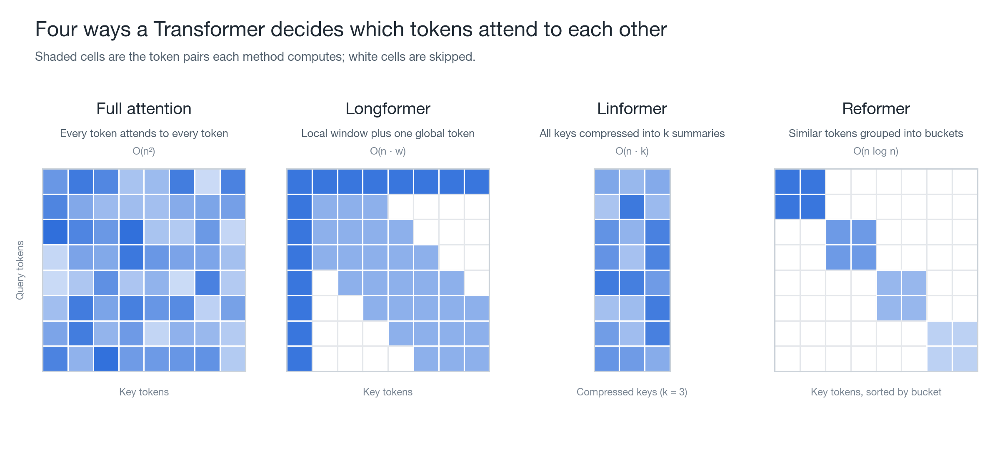
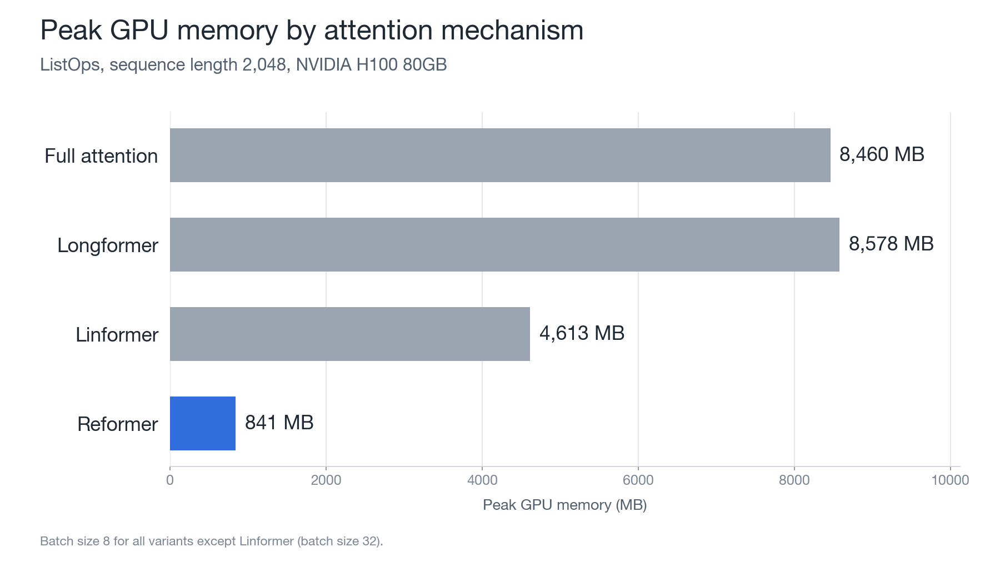

# Beyond Quadratic: Efficient Transformer Attention

MSc Computer Science dissertation, University of Liverpool (2026).

A controlled comparison of three efficient attention mechanisms (**Longformer**, **Linformer** and **Reformer**) against standard full self-attention. All four are implemented from scratch in PyTorch and run inside the same encoder, so the attention mechanism is the only thing that changes between experiments.



## Why

Standard self-attention computes a score for every pair of tokens, so its time and memory cost grows as O(n²) with sequence length. Efficient variants reduce this cost in different ways, but each original paper reports results under different conditions. This project compares them under identical architecture, training and evaluation settings.

| Variant | Approach | Complexity |
|---|---|---|
| Baseline | Full scaled dot-product attention | O(n²) |
| Longformer | Sliding window plus a global token | O(n · w) |
| Linformer | Low-rank projection of keys and values | O(n · k) |
| Reformer | Locality-sensitive hashing into buckets | O(n log n) |

## Results

Evaluated on two [Long Range Arena](https://github.com/google-research/long-range-arena) tasks on NVIDIA H100 80GB GPUs (Barkla HPC, University of Liverpool). Accuracy is the mean ± std over seeds 42, 1 and 2.

**ListOps** (sequence length 2,048)

| Variant | Accuracy (%) | Inference (ms) | Peak memory (MB) |
|---|---|---|---|
| Baseline | 18.82 ± 0.40 | 48.7 | 8,460 |
| Longformer | 17.08 ± 0.05 | 68.1 | 8,578 |
| Linformer* | 17.32 ± 0.08 | 78.6 | 4,613 |
| Reformer | 17.08 ± 0.05 | 35.7 | 841 |

\*Linformer was run with batch size 32; the other variants used batch size 8.

**Text Classification**, byte-level IMDb (sequence length 4,096)

| Variant | Accuracy (%) | Inference (ms) | Peak memory (MB) |
|---|---|---|---|
| Baseline | Out of memory at batch size 1 | – | – |
| Longformer | Out of memory at batch size 1 | – | – |
| Linformer | 51.94 ± 0.11 | 1.6 | 140 |
| Reformer | 60.39 ± 1.32 | 6.7 | 140 |



### Notes and limitations

- The Longformer implementation builds the full n×n score matrix and then masks it to the window. Its memory use therefore matches the baseline. A true sparse implementation is left for future work.
- Models are smaller than in the original papers, and hyperparameters were not tuned extensively because of compute limits.
- Linformer overfits on Text Classification: training accuracy goes above 90% while test accuracy stays around 52%.
- The sequence-length benchmark (`scripts/benchmark_seq_len.py`) was run on Apple Silicon (MPS), not CUDA, so its timings are noisy.

## Project structure

```
baseline/     Full self-attention and the shared encoder (BaselineTransformerEncoder)
longformer/   Sliding-window + global token attention
linformer/    Low-rank projected attention
reformer/     LSH bucketed attention
configs/      YAML experiment configs
scripts/      Training, evaluation, benchmarking and plotting
tests/        Unit tests for each variant (18 in total)
results/      Logs, evaluation JSON and plots
```

Each attention class is passed into the shared encoder (`attn_cls`), so swapping the mechanism does not change anything else in the model.

## Running it

```bash
pip install -r requirements.txt

# unit tests
python3 tests/test_baseline.py
python3 tests/test_longformer.py
python3 tests/test_linformer.py
python3 tests/test_reformer.py

# ListOps data (generate the TSVs with data/listops.py first)
python3 scripts/preprocess_listops.py

# train and evaluate one variant
python3 scripts/train.py --variant reformer --task listops --seed 42
python3 scripts/evaluate.py --variant reformer --task listops

# plots and sequence-length benchmark
python3 scripts/visualise.py --task listops
python3 scripts/benchmark_seq_len.py
```

Text Classification loads IMDb through TensorFlow Datasets automatically.

## Stack

Python, PyTorch, NumPy, Matplotlib, TensorFlow Datasets. Experiments were run on a SLURM-managed GPU cluster.

## License

MIT
